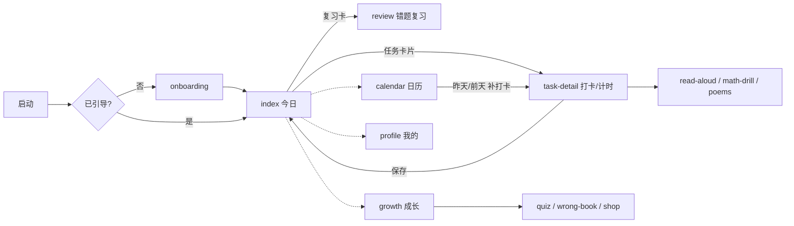

# 设计规范与信息架构

> 对应版本 v0.24.0。页面清单以 `app.json` 为准；数据作用域见 [data-model.md](data-model.md)。

## 1. 信息架构

同一个小程序有两种身份（首次引导时选择，「我的」页可切换）：**孩子端**在本机打卡；**家长端**用自己的微信绑定孩子后只读查看，并能发鼓励留言（需云开发）。

```
启动
├─ 未初始化 → reLaunch → onboarding（身份 → 年级 → 昵称/头像/学校）
│
├─ index 今日【Tab 1】
│  ├─ 孩子端：计时中卡片 / 本周小目标（操作菜单选目标）/ 家长留言横幅（表情回复）/ 今日错题复习卡 / 任务清单
│  │   ├─ 任务卡片 → task-detail（打卡 / 更新 / 取消；时长类任务可计时）
│  │   │    └─ 跟读 → read-aloud · 口算 → math-drill · 古诗 → poems
│  │   ├─ 复习卡 → review（到期错题，每组 5 题）
│  │   └─ 计时中卡片 → task-detail（回到计时）
│  └─ 家长端：绑定邀请码 / 孩子今日进度 / 本周达成条 / 孩子的本周目标 / 上周周报摘要 → report（卡片内可订阅每周一推送）
│      ├─ 给孩子留言 → cheer（写留言 + 已发出列表与回复）
│      └─ 点孩子已完成的任务 → cheer（为这次打卡点赞）
├─ calendar 日历【Tab 2】—— 月历热力图 + 单日明细（补卡标「补」）
│  └─ 孩子端点昨天/前天 → 补打卡区 → task-detail（补卡模式，家长确认）
├─ growth 成长【Tab 3】—— 称号 / 连击 / 周分布 / 勋章墙
│  └─ 入口：每周一卷 → quiz · 错题本 → wrong-book（→ review）· 学期成长报告 → term · 奖励小铺 → shop（仅孩子端）
└─ profile 我的【Tab 4】—— 资料 / 家人绑定 / 提醒订阅 / 数据（导出 · 导入 · 一键清空）
   └─ 家长设置（在孩子手机上）：任务管理 → tasks-manage · 家长报告 → report · 奖品管理 → shop?manage=1
```

页面流转（孩子端主路径）：



家长端主路径：`onboarding（我是家长）→ index 输入邀请码绑定 → 只读查看 index / calendar / growth / wrong-book / report / term → cheer 留言`。家长端所有页面从 `utils/context.js` 的 `scope()` 读孩子数据缓存；打卡、计时、补卡、复习、兑换等写操作在家长端不出现。

## 2. 视觉规范

**风格**：暖奶油底色 + 活力橙主色，大圆角、大字号、emoji 图标体系 —— 低龄友好、零图片资源、包体极小。

### 色板

| 用途 | 色值 |
| --- | --- |
| 页面底色 | `#FFF6E9` |
| 主色（按钮/进度/选中） | `#FF8A00`，浅档 `#FFF1DC` / `#FFB25A` |
| 卡片 | `#FFFFFF`，圆角 24-28rpx，投影 `rgba(255,143,31,.07)` |
| 正文 / 次要文字 | `#33302B` / `#9A948B` |
| 达成 / 正确 | `#2F9E44`，浅底 `#E8F8EC` |
| 错误 / 危险操作 | `#E5484D`（文字）、`#FF5A3C`（清空等按钮） |
| 家长留言 | `#FF6B81`，浅底 `#FFF1F3`，描边 `#FFD3DA` |

### 板块色（学科辨识，全站一致；定义在 `utils/tasks.js` 的 `SECTIONS`）

| 板块 | 主色 | 浅底 |
| --- | --- | --- |
| 语文 | `#FF6B6B` | `#FFEBEB` |
| 数学 | `#4D96FF` | `#E8F1FF` |
| 英语 | `#9B5DE5` | `#F3EAFE` |
| 学习（假期作业，仅假期出现） | `#A9746E` | `#F3EAE5` |
| 运动 | `#37B24D` | `#E8F8EC` |
| 娱乐 | `#F59F00` | `#FFF4D6` |
| 习惯 | `#12B5B0` | `#E0F7F6` |

### 字号 / 间距

- 页面标题 40rpx、卡片标题 32rpx、正文 28rpx、辅助 24rpx、角标 20-22rpx；计时数字 88rpx、口算题面 76rpx
- 卡片内边距 24-32rpx，页面左右留白 24rpx，卡片间距 24rpx
- 触控目标 ≥ 84rpx（儿童手指操作；数字键盘、表情回复按钮均按此尺寸）

## 3. 关键组件

| 组件 | 位置 | 说明 |
| --- | --- | --- |
| 进度环 | 首页 | CSS `conic-gradient` 实现，中心显示 `done/total`，无 canvas 依赖 |
| 任务卡片 | 首页 | emoji 方块 + 名称 + 必做角标 + 目标行 + 右侧状态（未完成空心圆 / 完成⭐n） |
| 本周小目标卡 | 首页 | 未定目标时为「去选择」，点开 `wx.showActionSheet` 选 4 个预设之一；已定时为进度条，达成变绿并锁定 |
| 计时中卡片 | 首页 | 有进行中的计时才出现，显示任务与已计分钟，点击回到任务页 |
| 留言横幅 | 首页（孩子） | 粉色卡片「💌 妈妈说」+ 一排固定表情（❤️😊💪🤗👍），点一个即回复并换下一条 |
| 复习卡 | 首页（孩子） | 有到期错题时显示「N 道错题到复习时间」，当天复习过显示 ✓ |
| 周报卡 | 首页（家长）/ 报告页 | 打卡/达成天数（↑↓ 对比前一周）、练习概况、孩子的周目标、亮点 🌟 与需关注 💡 |
| 步进器 + 快捷档 | task-detail | ±5/±10 步进；快捷档取目标值的 1/2/3 倍 |
| 计时卡 | task-detail | 时长类任务：大号倒计时 → 到点震动一次 → `+MM:SS` 超时；暂停/继续、结束并填入、放弃 |
| 星级自评 | task-detail | 😅加油(1⭐) 😊不错(2⭐) 🤩超棒(3⭐)；补卡模式隐藏（固定 1⭐） |
| 数字键盘 | math-drill / review | 3×4 大按键，⌫ 删除、✓ 提交；答错时题面变红并显示正确答案 |
| 选项按钮 | quiz / review | 单选即判；多选点选后「提交本题」；判后绿=正确、红=选错 |
| 月历格 | calendar | 绿底圆=达成、黄底圆=有打卡、空心=未打卡、描边=今天/选中 |
| 学期报告 | term | 顶部 ‹ › 在学期与寒暑假之间翻（最远到当前）；四格 KPI + 成长亮点 + 累计六宫格 + 练习 + 勋章 |
| 补打卡区 | calendar（孩子） | 昨天/前天且有未打卡任务时出现：剩余额度 + 任务列表；额度用完时置灰并说明 |
| 勋章格 | growth | 未获得灰度+❓制造收集欲，已获得亮起+日期 |
| 跟读卡片 | read-aloud | 三态：空闲(🎙️录音)→录音中(⏹停止+计时脉冲)→已录(▶️播放/🔁重录/时长)；录音仅存本机 |
| 自定义 tabBar | 全局 | emoji 图标，无图片资源依赖 |

## 4. 关键交互

1. **打卡流**：点卡片 → 详情页 → 填数值/星级 → 保存 → 轻震动 + toast（新勋章优先播报）→ 返回自动刷新。已打卡可进入更新或取消。
2. **计时打卡**：时长类任务点「开始计时」→ 可离开页面/锁屏（按开始时间推算，不丢时间）→ 到目标时长震动提示一次 →「结束并填入」把整分钟数填进完成量，孩子再评星后打卡。同时只能有一个计时；不满 1 分钟不能结束。
3. **家长确认**（在孩子手机上弹 `wx.showModal`）：屏幕时间类任务首次保存；补打卡每次保存。
4. **补打卡**：日历点昨天/前天 → 选没打卡的任务 → 补卡模式（标题带「补打卡」、不评星）→ 家长确认 → 记 1⭐ 并接上连击。每周最多补 2 天。
5. **连击保护**：今天还没打卡时，连击数按"到昨天为止"计算并展示，避免清晨打开就看到断签挫败感。
6. **每周小目标**：首页卡片选目标 → 进度条随打卡/复习自动前进 → 首次达成时 toast「🎯 周目标达成 +5⭐」。达成前可以换，达成后锁定；周末达成后下周一打开也会补记。
7. **错题复习**：答错的题进错题本 → 按 1/3/7 天到期出现在复习队列 → 到期答对升一轮，连对 3 次移出；未到期答对不变。
8. **家长留言**：家长写一句（或点常用语）→ 孩子首页横幅 → 孩子点表情回复 → 家长首页与已发出列表看到回复。
9. **防误触/防焦虑**：取消打卡需二次确认；清空数据需两次确认且提示先导出备份；开通云开发后先清云端、成功才清本机，失败时本机不动并可「稍后重试 / 只清本机」。

## 5. 可用性考量（面向 6-11 岁用户）

- 所有任务用 emoji + 颜色双编码，一年级孩子也能"看图识字"找到自己的任务
- 必做/自选分级，避免清单过长造成畏难；首页只呈现"今天"
- 文案全部口语化（"太棒啦！""快去开始吧！"），不使用说教语气；需关注项用温和建议（"可以先回到低一级巩固"），不用批评
- 星星即时反馈 + 每日目标只有一条简单规则（完成必做）
- 孩子侧不需要打字：留言回复只用固定表情，计时代替手填分钟，口算用大按键数字键盘
- 只和昨天的自己比：没有排行榜；周报与"需关注"面向家长（家长手机首页，或孩子手机「我的」里的家长设置），孩子首页不展示
